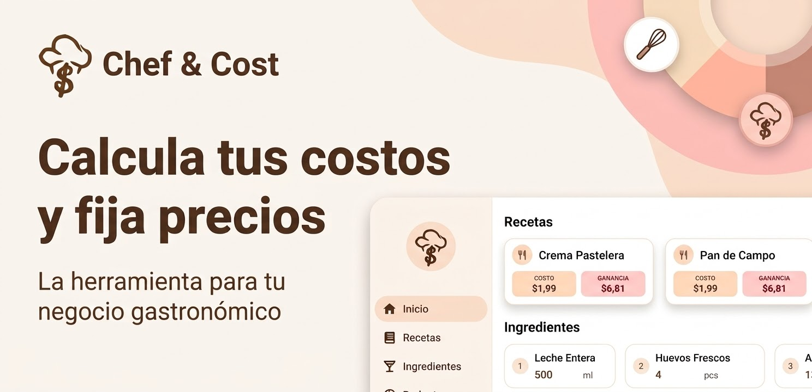

<h1 align="center" style="font-size:32px; line-height:1.1"><b>Chef&Cost</b></h1>

<p align="center">
  <b>Culinary Recipe Management, Dynamic Ingredient Scaling & Food Costing Engine</b><br/>
  <code>com.chefandcost.app</code>
</p>

<div align="center">
  <a href="">
    
  </a>
</div>

<br />

<div align="center">
  <a href="">
    
  </a>
</div>

<br />

<div align="center">


%20%7C%20Windows%20%7C%20macOS%20%7C%20Linux-EBBB9B?style=flat-square&labelColor=3B2314)


</div>

---

## ✨ Core Product Features

Chef&Cost is an offline-first culinary management and food costing application designed for chefs, pastry artists, bartenders, and food businesses. Brand assets—including [`Chef&CostIcono.svg`](assets/images/Chef&CostIcono.svg) and [`Chef&CostLogo.svg`](assets/images/Chef&CostLogo.svg)—are bundled under `assets/images/`.

### 1. Precision Recipe Costing & Financial Breakdown
- **Real-Time Costing Engine:** Automatically computes total recipe cost, cost per portion/yield (`defaultYield`, `yieldName`), target profit margin (`targetProfitMargin`), and suggested selling price per portion (`targetPricePerPortion`).
- **Dynamic Recipe Scaling:** Scale any recipe by desired portion count or by the available quantity of a specific ingredient—recalculating every ingredient amount and financial metric instantaneously.

### 2. Smart Recipe Editor (`lib/screens/recipe_editor_screen.dart`)
- **Live Ingredient Highlighting:** Powered by [`IngredientTextEditingController`](lib/utils/ingredient_text_editing_controller.dart), recognized ingredient names inside preparation steps are automatically highlighted and color-coded as you type.
- **Inline Interactive Kitchen Timers:** Embed timers directly inside preparation steps using the `[timer:Label|Seconds]` syntax. Timers run on a background ticker with an audio alarm (`assets/audio/alarm.wav`) and local push notifications managed by [`lib/provider/timers_provider.dart`](lib/provider/timers_provider.dart).

### 3. Multi-Space Organization & Categories
- **System Categories:** Built-in culinary categories (`Cocina`, `Pastelería`, `Coctelería` in [`lib/database/recipe_category.dart`](lib/database/recipe_category.dart)) rendered with color-coded `RecipeCategoryBadge` indicators.
- **Custom Groups & Spaces:** Isolate or filter recipes and ingredient inventories across different kitchens, brands, or projects using `ActiveGroupChip` and `GroupManagementSheet`.

### 4. Ingredient Inventory & Smart Unit Conversion
- **Centralized Inventory (`lib/screens/ingredients_screen.dart`):** Manage ingredient prices, suppliers, and package sizes in one place.
- **Culinary Unit Engine (`lib/utils/unit_utils.dart`):** Supports mass, volume, and discrete unit conversions (including culinary and cocktail measurements) with automatic unit merging and price-per-unit normalization when editing or importing ingredients.

### 5. Built-in Culinary & Costing Toolkit (`lib/screens/tools_screen.dart`)
- **Compare Ingredients (`CompareIngredientsScreen`):** Side-by-side price-per-unit comparison to identify the most cost-effective supplier or package size.
- **Unit Converter (`UnitConverterScreen`):** Instant conversion across weight, volume, and culinary units.
- **Rule of Three Calculator (`RuleOfThreeScreen`):** Rapid proportional scaling calculator for everyday kitchen workflows.
- **Multi-Timer Dashboard (`KitchenTimersScreen`):** Run multiple concurrent color-coded timers with `+1m` / `+5m` quick adjustments and completion timestamps.

### 6. Custom `.chefy` File Format & Native Sharing
- **Portable Recipe Packages (`lib/services/recipe_share_service.dart`, `lib/services/recipe_file_intent_service.dart`):** Export and import complete recipes (ingredients, steps, embedded timers, and cost data) as `.chefy` files with smart conflict detection (`ImportRecipeDialog`).
- **OS File Associations:** Native file intent handling on Android and iOS, plus automatic Windows Registry `HKCU` `.chefy` file association via [`lib/services/windows_registry_helper.dart`](lib/services/windows_registry_helper.dart).

---

## ☁️ Cloud Sync, Security & Monetization Architecture

### Hybrid Cloud Synchronization
- **Real-Time Delta Sync:** Incremental synchronization with **Cloud Firestore** (`lib/provider/cloud_sync_provider.dart`, `lib/utils/firestore_sync_service.dart`).
- **Google Drive SQLite Backups:** Full SQLite database backup and restore via **Google Drive** (`appDataFolder` / file backups in `lib/utils/cloud_sync_service.dart`), guarded by `PRAGMA quick_check` SQLite integrity validation (`lib/utils/sqlite_validator_io.dart`).

### Google Play Integrity & Billing Fraud Defense
- **Play Integrity Verification:** Native Android `StandardIntegrityManager` (with Classic fallback in `lib/services/play_integrity_service.dart`) verifies all 7 Google Play Integrity signals through Node.js / Firebase Cloud Functions (`functions/index.js`, `functions/playIntegrityVerifier.js`, and `backend/`).
- **Monetization & Abuse Prevention:** Play Billing fraud protection using obfuscated account and profile identifiers, supporting Pro subscriptions (`SubscriptionPaywallCard`) and rewarded Ad-Free passes (`AdFreePassButton`).

---

## 🎨 UI/UX, Accessibility & Internationalization

- **Warm Mocha Material 3 Design System (`lib/theme/app_theme.dart`):**
  - Crafted around a Warm Mocha palette (`#6B3C22` primary & `#EBBB9B` accent) with full Light and Dark themes.
  - **Accessibility Controls:** High-contrast text mode, toggleable motion/animations (`NoTransitionsBuilder`), and **6 typography presets** (`Metropolis`, `Butler`, `Nunito`, `Inconsolata`, `Amatic SC`, `Caveat`).
  - **Custom Components:** `FloatingPillAppBar` with organic blur, `GooeyToast` notifications, and guided interactive onboarding (`AppTutorialService`).
- **Massive Localization (`lib/l10n/`):**
  - Out-of-the-box support for **57 languages** (`.arb` files), kept in sync via [`scripts/sync_translations.dart`](scripts/sync_translations.dart).
  - Community translations sheet: [Google Sheets](https://docs.google.com/spreadsheets/d/1URmpVdxm1Eb4_hpAHPuT58OKXW6qobx2y4XevcXxxyQ/edit?usp=sharing) — reach out to `kbradevp@gmail.com` to contribute.

---

## 🛠️ Tech Stack

| Layer | Technology |
| :--- | :--- |
| **Framework & Language** | Flutter (Cross-platform), Dart (`^3.11.5`) |
| **State Management** | `flutter_riverpod` (`^3.3.1`) |
| **Local Database** | Drift (`^2.32.1`), `sqlite3`, Web WASM worker (`web/sqlite3.wasm`, `web/drift_worker.js`) |
| **Cloud & Backend** | Firebase (`firebase_core`, `firebase_auth`, `cloud_firestore`), Firebase Cloud Functions (`functions/`), Node.js (`backend/`) |
| **Cloud Storage** | Google Drive API (`googleapis`, `googleapis_auth`, `google_sign_in`) |
| **Monetization & Security** | Google Mobile Ads (`google_mobile_ads`), In-App Purchase (`in_app_purchase`), Google Play Integrity API |
| **Media, Export & UX** | `audioplayers`, `flutter_local_notifications`, `pdf`, `printing`, `csv`, `flutter_svg`, `tutorial_coach_mark` |

---

## 📁 Project Structure

```text
recipetools/
├── lib/
│   ├── database/        # Drift schema, DAOs, migrations, and recipe categories
│   ├── l10n/            # 57 ARB localization files & generated localizations
│   ├── provider/        # Riverpod providers (timers, cloud sync, billing, settings)
│   ├── screens/         # App screens (recipes, editor, ingredients, tools, settings)
│   ├── services/        # Play Integrity, .chefy sharing, file intents, Windows registry, tutorials
│   ├── theme/           # Warm Mocha Material 3 themes, typography presets, transitions
│   ├── utils/           # Unit conversions, Firestore/Drive sync, SQLite validator, text controller
│   └── widgets/         # Reusable UI components (FloatingPillAppBar, GooeyToast, badges, dialogs)
├── android/             # Native Android configuration, Kotlin/Java bridges, Play Integrity setup
├── backend/             # Standalone Node.js Play Integrity verifier (`server.js`)
├── functions/           # Firebase Cloud Functions (`index.js`, `playIntegrityVerifier.js`)
├── scripts/             # Build, distribution, l10n sync, icon generation, and dev server scripts
├── test/                # 48 automated unit & widget test suites
└── web/                 # Flutter Web entrypoints, WASM SQLite & Drift workers, legal pages
```

---

## 🚀 Developer Setup, Testing & Release

### Local Development
```bash
# Install dependencies
flutter pub get

# Generate Drift & localization code (if modified)
dart run build_runner build --delete-conflicting-outputs
flutter gen-l10n

# Run the app
flutter run
```

To serve the Flutter Web build locally with required COOP/COEP headers for SQLite WASM:
```bash
python scripts/serve_web.py
```

### Running Tests
The repository includes **48 automated test suites** under `test/`:
```bash
flutter test
```

### Production Builds & Distribution
- **Android 16 KB ELF Page-Aligned AAB (Google Play):**
  ```bash
  # Linux / macOS
  ./scripts/build_play_bundle.sh

  # Windows PowerShell
  ./scripts/build_play_bundle.ps1
  ```
- **Firebase App Distribution (APK):**
  ```bash
  ./scripts/distribute_apk.sh
  ```
- **iOS IPA (requires macOS):**
  ```bash
  flutter build ipa
  ```
- **Firebase Hosting & Functions Deployment:**
  ```bash
  firebase deploy
  ```
- **GitHub Releases:**
  1. Create and push a tag matching the version in `pubspec.yaml`:
     ```bash
     git tag <version>
     git push origin <version>
     ```
  2. Upload release binaries at [GitHub Releases](https://github.com/k-b-r-a/recipes_tools/releases/new).

---

## 🤝 Issues, Changelog & License

- **Changelog:** Full development history is documented in [GitHub Commits](https://github.com/k-b-r-a/recipes_tools/commits/main/).
- **Bug Reports & Feature Requests:** Open an issue in the [Issues](https://github.com/k-b-r-a/recipes_tools/issues) tab. Outside code pull requests are currently closed to maintain clear licensing and commercial rights.
- **License:** See [`LICENCE`](LICENCE).
